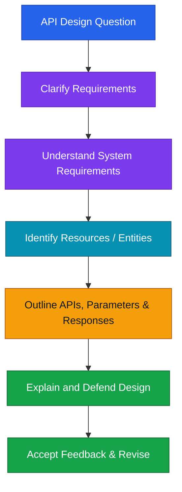

# API Design Interview — বাংলা নোট

## API Design Interview কী?

এখানে API implement করা নয়; API-এর resources, parameters এবং responses design করে outline করতে হয়।

## API Design-এর ধাপ

## 1. Clarify Requirements

- কোন functionality design করতে হবে? যেমন: Home Timeline নাকি Trending tab?
- API কারা ব্যবহার করবে—internal নাকি external users?

## 2. Understand System Requirements

- কতজন user API ব্যবহার করবে?
- ব্যবহারকারীরা কোন region থেকে আসবে?
- কী ধরনের data ও payload আদান-প্রদান হবে?

## 3. Identify Resources / Entities

Twitter API-এর উদাহরণ:

- **User**
- **Tweet**
- প্রতিটি resource-এর properties / attributes

## 4. Outline the API

- API endpoints
- Path parameters ও query parameters
- Request / response structure এবং response fields

> Interview-তে API-এর design outline করতে হবে; পুরো implementation logic লিখতে হবে না।

## 5. Discuss and Improve

নিজের design-এর কারণ ব্যাখ্যা করো, interviewer-এর feedback শোনো এবং প্রয়োজন হলে design revise করো।

## Practice

প্রথমে Twitter Timeline API নিজে design করো। তারপর Twitter-এর API reference-এর parameters ও sample response-এর সঙ্গে তুলনা করো।

## 🧠 Memory Trick

**Ask → Understand → Identify → Outline → Defend → Revise**
