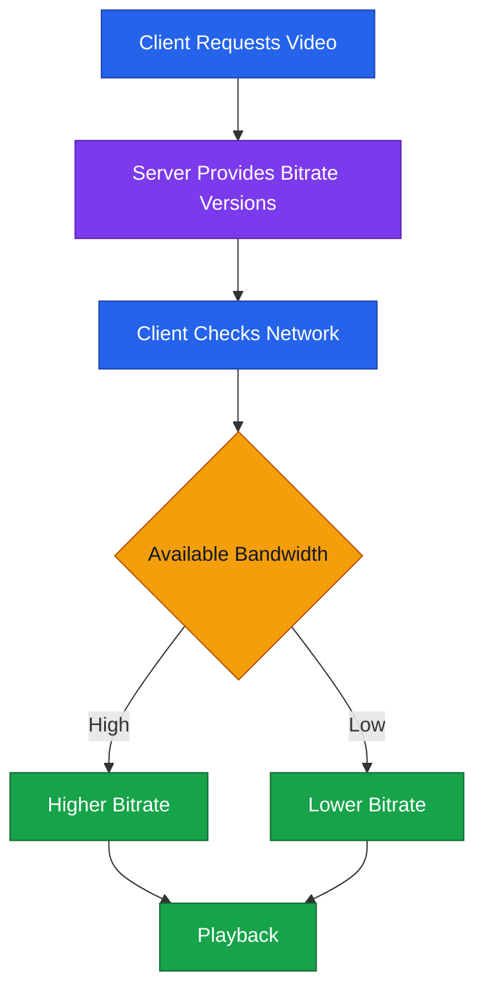
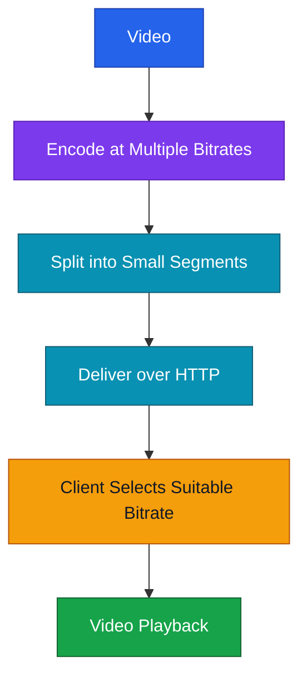

# 🎬 Video Streaming — System Design Notes (বাংলা)

## 1. Video Streaming কী?

Video Streaming-এর মাধ্যমে সম্পূর্ণ video download হওয়ার অপেক্ষা না করে Internet-এ video দেখা যায়। Video ও audio ছোট ছোট **packets** হিসেবে device-এ আসে, তারপর device সেগুলো সাজিয়ে play করে।

## 2. Video Streaming-এর ধরন

- **Live Streaming:** Live event, sports, concert বা news real time-এ সম্প্রচার করা।
- **On-Demand Streaming:** আগে record করা movie, TV show বা video যেকোনো সময় দেখা।
- **Peer-to-Peer (P2P):** Viewers নিজেদের bandwidth ও computing resources ব্যবহার করে content বিতরণে সাহায্য করে।

## 3. Bitrate

**Bitrate** হলো প্রতি সেকেন্ডে audio বা video উপস্থাপনের জন্য ব্যবহৃত data-এর পরিমাণ।

- **Higher bitrate:** সাধারণত বেশি quality, তবে বেশি bandwidth ও storage লাগে।
- **Lower bitrate:** কম bandwidth লাগে, তবে quality কম হতে পারে।

## 4. Adaptive Bitrate Streaming (ABS)

ABS network speed অনুযায়ী video quality স্বয়ংক্রিয়ভাবে পরিবর্তন করে, যাতে buffering বা interruption কম হয়। Server video-র একাধিক bitrate version সরবরাহ করে। Client বর্তমান network condition অনুযায়ী উপযুক্ত version বেছে নেয় এবং condition পরিবর্তন হলে অন্য bitrate-এ switch করতে পারে।

## 5. Streaming Protocols

Transcript-এ উল্লেখ করা protocol ও technology:

- **HLS** — HTTP Live Streaming
- **DASH** — Dynamic Adaptive Streaming over HTTP
- **RTMP** — Real-Time Messaging Protocol
- **HTTP Streaming**

### DASH কীভাবে কাজ করে?

DASH video-কে ছোট ছোট segments-এ ভাগ করে HTTP-এর মাধ্যমে deliver করে। Client available bandwidth অনুযায়ী প্রতিটি segment-এর bitrate version বেছে নিতে পারে।

## 6. কেন System Design-এ গুরুত্বপূর্ণ?

Video streaming-এর ক্ষেত্রে **servers, networks এবং client devices**-এর মধ্যে interaction বুঝতে হয়। তাই এটি distributed systems design ও optimization বোঝার একটি গুরুত্বপূর্ণ topic।

## 🧠 Quick Revision

| Term            | মূল ধারণা                                      |
| --------------- | ---------------------------------------------- |
| Video Streaming | সম্পূর্ণ download-এর অপেক্ষা না করে video দেখা |
| Live Streaming  | Real-time broadcast                            |
| On-Demand       | Pre-recorded video যেকোনো সময় দেখা             |
| P2P             | Viewers content বিতরণে সাহায্য করে             |
| Bitrate         | প্রতি সেকেন্ডে audio/video data                |
| ABS             | Network অনুযায়ী bitrate/quality বদলায়          |
| DASH            | HTTP দিয়ে ছোট video segments deliver করে       |
