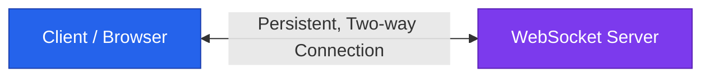
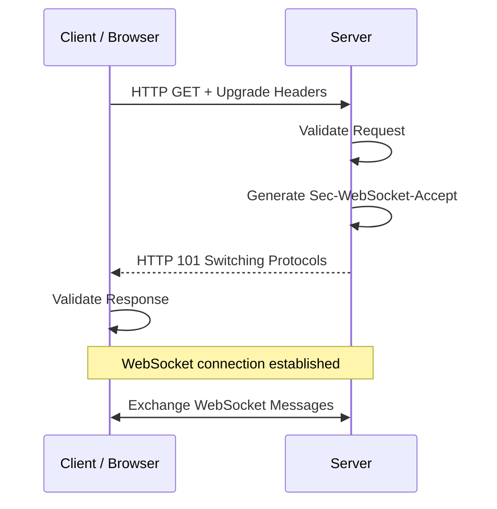
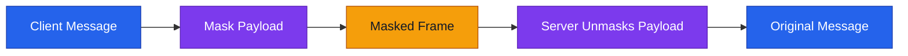
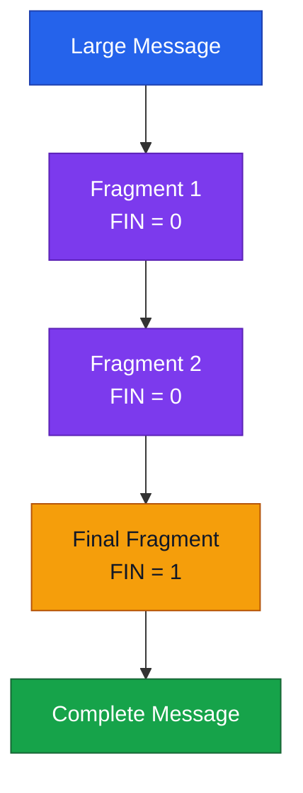

# 🔌 Advanced WebSocket — System Design Notes (বাংলা)

## 1. WebSocket কী?

**WebSocket** হলো TCP-ভিত্তিক একটি protocol, যা connection established হওয়ার পর Client ও Server-কে একই connection দিয়ে দুই দিকেই real-time message আদান-প্রদান করতে দেয়।



## 2. WebSocket Handshake

Handshake হলো HTTP request দিয়ে WebSocket connection-এ upgrade করার প্রক্রিয়া।



### গুরুত্বপূর্ণ Headers

| Header                   | কাজ                                                              |
| ------------------------ | ---------------------------------------------------------------- |
| `Upgrade: websocket`     | WebSocket-এ upgrade করার অনুরোধ                                  |
| `Connection: Upgrade`    | Protocol upgrade চাওয়া হয়েছে বোঝায়                               |
| `Sec-WebSocket-Key`      | Handshake-এর জন্য Client-এর তৈরি random Base64-encoded key       |
| `Sec-WebSocket-Version`  | WebSocket protocol version জানায়                                 |
| `Sec-WebSocket-Protocol` | প্রয়োজন হলে application subprotocol প্রস্তাব করে                 |
| `Sec-WebSocket-Accept`   | Server-এর তৈরি value, যা Client handshake যাচাই করতে ব্যবহার করে |

Successful handshake-এ Server `HTTP 101 Switching Protocols` response পাঠায়। Status `101` না হলে WebSocket connection প্রতিষ্ঠিত হয় না।

## 3. `ws://` বনাম `wss://`

- **`ws://`** — সাধারণ WebSocket connection; default port **80**।
- **`wss://`** — TLS-সুরক্ষিত WebSocket connection; default port **443**।

```text
ws://example.com/chat
wss://example.com/chat
```

`wss://` connection-এ TLS ব্যবহার করা হয়। WebSocket handshake নিজে Client-এর identity authenticate করে না; authentication প্রয়োজন হলে তা আলাদাভাবে implement করতে হয়।

## 4. WebSocket Frame

Connection তৈরি হওয়ার পর data **Frames** আকারে আদান-প্রদান হয়। একটি message এক Frame-এ থাকতে পারে বা একাধিক Frame-এ ভাগ হতে পারে।

```text
┌─────────────────────────────┐
│ FIN                         │
├─────────────────────────────┤
│ RSV1 | RSV2 | RSV3          │
├─────────────────────────────┤
│ Opcode                      │
├─────────────────────────────┤
│ MASK                        │
├─────────────────────────────┤
│ Payload Length              │
├─────────────────────────────┤
│ Masking Key (if present)    │
├─────────────────────────────┤
│ Payload Data                │
└─────────────────────────────┘
```

| Field              | কাজ                                           |
| ------------------ | --------------------------------------------- |
| **FIN**            | Frame-টি message-এর শেষ fragment কি না বোঝায়  |
| **RSV1–RSV3**      | Extension-এর জন্য reserved bits; সাধারণত zero |
| **Opcode**         | Frame-এর ধরন বোঝায়—যেমন text, binary বা ping  |
| **MASK**           | Payload masked কি না বোঝায়                    |
| **Payload Length** | Payload-এর data length                        |
| **Masking Key**    | Masking প্রয়োগে ব্যবহৃত key                   |
| **Payload Data**   | Message-এর আসল content                        |

## 5. Masking কী?

WebSocket protocol-এ Client থেকে Server-এ পাঠানো Frame-এর payload **masked** হতে হয়। Server থেকে Client-এ পাঠানো Frame সাধারণত masked হয় না।

Masking-এর উদ্দেশ্য হলো WebSocket traffic-কে ভুলভাবে HTTP traffic হিসেবে ব্যাখ্যা বা manipulate করা কঠিন করা। **Masking encryption নয়**; secure transport-এর জন্য `wss://`-এর TLS ব্যবহৃত হয়।



## 6. Fragmentation কী?

**Fragmentation** হলো বড় WebSocket message-কে একাধিক ছোট Frame-এ ভাগ করে পাঠানো।

- শেষ fragment ছাড়া অন্য fragment-এ `FIN = 0` থাকে।
- শেষ fragment-এ `FIN = 1` থাকে।
- Receiver fragment-গুলো মিলিয়ে সম্পূর্ণ message তৈরি করতে পারে।



Fragmentation বড় message ধাপে ধাপে পাঠাতে সাহায্য করে। এটি নিজে থেকেই সব ধরনের buffer overflow ঠেকানোর নিশ্চয়তা দেয় না।

## 7. WebSocket কোথায় ব্যবহার হয়?

- **Chat applications:** দ্রুত message পাঠানো ও গ্রহণ করা।
- **Web applications:** Page-এর live changes ও updates পাঠানো।
- **Multiplayer games:** Real-time game updates।
- **Collaborative drawing:** একই canvas-এ একাধিক user-এর changes আদান-প্রদান।
- **Stock ticker:** Share price-এর real-time updates।

## 🧠 Quick Revision

| Topic         | মনে রাখার বিষয়                                   |
| ------------- | ------------------------------------------------ |
| Handshake     | HTTP request দিয়ে WebSocket upgrade শুরু হয়      |
| `101`         | Successful protocol upgrade                      |
| `ws://`       | Default port 80                                  |
| `wss://`      | TLS-সুরক্ষিত; default port 443                   |
| Frame         | WebSocket data-এর মৌলিক একক                      |
| Masking       | Client-to-server Frame masked; এটি encryption নয় |
| Fragmentation | বড় message-কে একাধিক Frame-এ ভাগ করা             |
| Use cases     | Chat, gaming, live updates, collaborative apps   |

### Interview Answer

**“WebSocket is a TCP-based protocol that provides persistent, bidirectional communication. It starts with an HTTP Upgrade handshake, then exchanges data in frames. Masking is required for client-to-server frames, and fragmentation allows a message to be sent across multiple frames.”**
