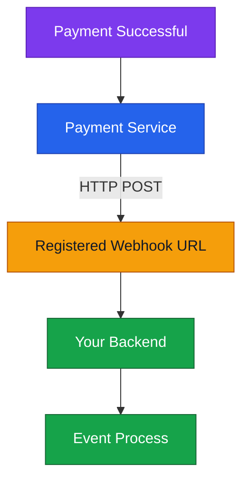
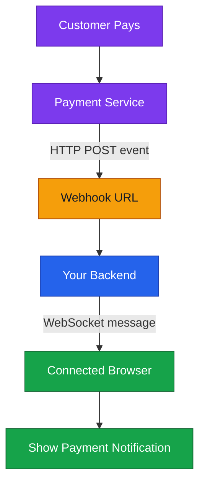

# Webhook vs WebSocket — বাংলা নোট

## 1. Webhook কী?

**Webhook** হলো event ঘটলে একটি system অন্য system-এর registered URL-এ স্বয়ংক্রিয়ভাবে HTTP request (সাধারণত POST) পাঠানোর ব্যবস্থা।

উদাহরণ: Payment successful হলে payment service তোমার backend-এর webhook URL-এ event পাঠায়।

## 2. WebSocket কী?

**WebSocket** connection establish হওয়ার পর একই connection ব্যবহার করে দুই দিকের মধ্যে real-time message আদান-প্রদান করতে দেয়।

## 3. WebSocket কি Webhook-এর Alternative?

**কিছু ক্ষেত্রে হ্যাঁ, কিন্তু সব ক্ষেত্রে নয়।**

- নিজের system-গুলোর মধ্যে live notification পাঠাতে WebSocket ব্যবহার করা যেতে পারে—যদি দুই পাশেই সেই connection support করা হয়।
- External service (যেমন Stripe) event জানানোর জন্য যে mechanism দেয়, সেটি ব্যবহার করতে হয়। Service যদি webhook-এর মাধ্যমে event পাঠায়, নিজের দিক থেকে WebSocket চালু করলেই webhook বাদ দেওয়া যায় না।
- Webhook এবং WebSocket একই system-এ একসঙ্গে কাজ করতে পারে।

## 4. দুটো একসাথে কীভাবে কাজ করে?

## 5. পার্থক্য এক নজরে

| বিষয়         | Webhook                                                                                          | WebSocket                                             |
| ------------ | ------------------------------------------------------------------------------------------------ | ----------------------------------------------------- |
| মূল কাজ      | Event হলে URL-এ HTTP request পাঠানো                                                              | খোলা connection-এ real-time message আদান-প্রদান       |
| Connection   | Event ঘটলে request পাঠায়                                                                         | সাধারণত connection খোলা থাকে                          |
| উদাহরণ       | Payment service → Backend                                                                        | Backend → Browser                                     |
| Alternative? | WebSocket কিছু ক্ষেত্রে একই notification goal পূরণ করতে পারে, কিন্তু সবসময় সরাসরি replacement নয় | Provider support ও connection setup-এর ওপর নির্ভর করে |

## 🧠 মনে রাখার কৌশল

- **Webhook:** “Event ঘটেছে—এই নাও HTTP notification।”
- **WebSocket:** “Connection খোলা আছে—চলো real-time message পাঠাই।”
